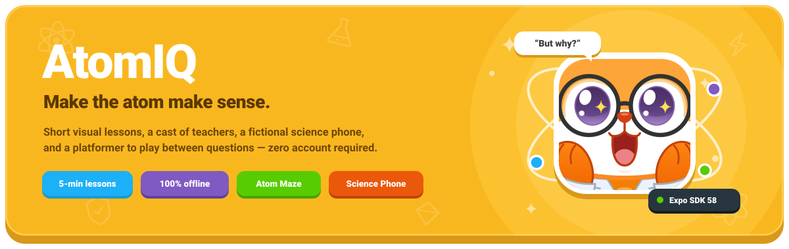
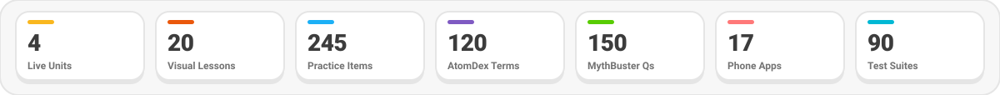
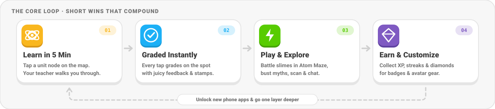
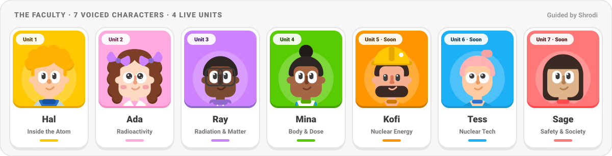
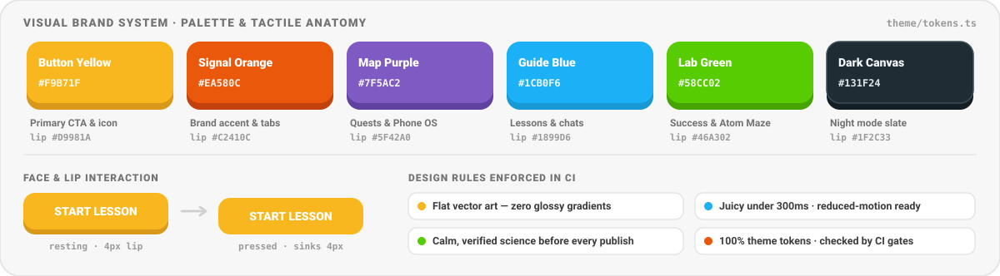
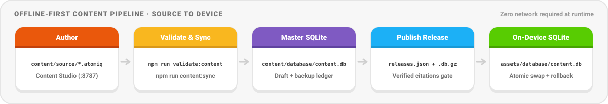

<div align="center">



<br />

<p>
  <a href="#the-loop"><b>The Loop</b></a>
  &nbsp;·&nbsp;
  <a href="#a-tour-of-the-app"><b>Tour the App</b></a>
  &nbsp;·&nbsp;
  <a href="#meet-the-cast"><b>Meet the Cast</b></a>
  &nbsp;·&nbsp;
  <a href="#visual-brand"><b>Visual Brand</b></a>
  &nbsp;·&nbsp;
  <a href="#built-to-work-offline"><b>Offline Architecture</b></a>
  &nbsp;·&nbsp;
  <a href="#get-started"><b>Get Started</b></a>
  &nbsp;·&nbsp;
  <a href="#documentation"><b>Docs</b></a>
</p>

<picture>
  <source media="(prefers-color-scheme: dark)" srcset="docs/brand/app-stats-dark.svg" />
  <source media="(prefers-color-scheme: light)" srcset="docs/brand/app-stats-light.svg" />
  
</picture>

</div>

<br />

> **Radiation, reactors, half-lives, and safety are easy to fear and hard to understand.**
> AtomIQ turns them into a path you can walk in five-minute steps — with a teacher beside every lesson, a fictional science phone in your pocket, and a game waiting when you finish. No account, no network, no lecture hall.

<p align="center">
  
</p>

## The Loop

<p align="center">
  <picture>
    <source media="(prefers-color-scheme: dark)" srcset="docs/brand/learning-loop-dark.svg" />
    <source media="(prefers-color-scheme: light)" srcset="docs/brand/learning-loop-light.svg" />
    
  </picture>
</p>

Every answer is graded the moment you tap. Every lesson closes on a celebratory stamp, a rolling count-up, and a sign-off from your teacher. Everything you earn flows somewhere tangible: a cosmetic **Shop**, an expandable **Phone**, a weekly **Feed** ranking, and tiered **Badges**.

<p align="center">
  
</p>

## A Tour of the App

Five bottom tabs, one curious mascot, and seventeen unlockable mini-apps inside your fictional phone.

<table>
  <thead>
    <tr>
      <th align="center" width="56">Icon</th>
      <th align="left" width="110">Tab</th>
      <th align="left">What happens there</th>
    </tr>
  </thead>
  <tbody>
    <tr>
      <td align="center"></td>
      <td><b>Home</b></td>
      <td>The lesson map: a winding 2.5D path of units, each painted in its teacher's signature colour. Tap a node for a pop-up bubble, launch a 5-minute visual lecture, and answer interactive cards with instant feedback.</td>
    </tr>
    <tr>
      <td align="center"></td>
      <td><b>Quests</b></td>
      <td>Daily and weekly goals with a treasure chest that opens when you clear the board and bursts out diamonds and flying XP coins.</td>
    </tr>
    <tr>
      <td align="center"></td>
      <td><b>Phone</b></td>
      <td>Your own simulated science smartphone. Start with 5 core apps (<b>Chats</b>, <b>Contacts</b>, <b>AtomDex</b>, <b>Daily Fact</b>, <b>Settings</b>) and unlock 12 more as you learn — including <b>Atom Maze</b>, <b>Myth Buster</b>, <b>3 Interactive Labs</b>, <b>Atom Scanner</b>, <b>Field Notes</b>, <b>Reference Library</b>, <b>Safety Guide</b>, <b>Nuclear Map</b>, <b>Camera</b>, and the <b>Shop</b>.</td>
    </tr>
    <tr>
      <td align="center"></td>
      <td><b>Feed</b></td>
      <td>Teachers post about milestones you actually hit, publish bite-sized science blog pieces, and compete on a weekly leaderboard. React with like, love, clap, or wow — intentionally zero comment boxes.</td>
    </tr>
    <tr>
      <td align="center"></td>
      <td><b>Profile</b></td>
      <td>Your custom avatar, learner passport, streaks, rank, and tiered achievement badges. Spend diamonds in the <b>Shop</b> on hairstyles, facial features, accessories, outfits, paints, and 37 vector wallpaper patterns.</td>
    </tr>
  </tbody>
</table>

### Inside the Science Phone & Arcade

- **Atom Maze** — A side-scrolling platformer across themed worlds (tutorial, evergreen forest, desert) where touching enemies triggers real physics question battles before unlocking the boss door.
- **Myth Buster** — Rapid-fire nuclear myth vs. fact in Quick Play, Challenge, and Endless modes across 150 sourced statements.
- **Interactive Labs** — Hands-on experiments (**Build an Atom**, **Decay Lab**, and **Radiation Shield**) that unlock alongside the lessons that introduce them.
- **Reference & Field Tools** — **AtomDex** (120 encyclopedia entries), an interactive **Periodic Table**, **Atom Scanner** (12 everyday radiation targets), **Safety Guide** (14 cards), **Nuclear Map** (18 global sites), **Field Notes**, and **Daily Facts**.

<details>
<summary><b>Explore the 4 live curriculum units (20 lessons · 217 teaching cards · 245 items)</b></summary>

<br />

| Unit                               | Teacher  | Subtitle                                         | What you master                                                                                                            |
| :--------------------------------- | :------- | :----------------------------------------------- | :------------------------------------------------------------------------------------------------------------------------- |
| **Unit 1: Inside the Atom**        | **Hal**  | _What everything is made of_                     | Protons, neutrons, electrons, elements, isotopes, and why some nuclei are stable while others change.                      |
| **Unit 2: Radioactivity**          | **Ada**  | _How unstable nuclei change_                     | Spontaneous decay, alpha/beta/gamma emissions, half-life patterns, decay chains, and natural background radioactivity.     |
| **Unit 3: Radiation Meets Matter** | **Ray**  | _What radiation does to things, and how we tell_ | Ionizing vs. non-ionizing radiation, shielding, exposure vs. contamination, Geiger counters, dosimeters, and Bq / Gy / Sv. |
| **Unit 4: Radiation and the Body** | **Mina** | _How much matters, and what you can do about it_ | Everyday doses, DNA repair, dose rate, time/distance/shielding, and how to read a scary headline calmly.                   |

</details>

<p align="center">
  
</p>

## Meet the Cast

<p align="center">
  <picture>
    <source media="(prefers-color-scheme: dark)" srcset="docs/brand/cast-lineup-dark.svg" />
    <source media="(prefers-color-scheme: light)" srcset="docs/brand/cast-lineup-light.svg" />
    
  </picture>
</p>

<table>
  <tr>
    <td align="center" width="150">
      
    </td>
    <td>
      <b>Shrodi</b> is AtomIQ's mascot and guide — leading onboarding (which plays two real questions before asking your name), hosting the interactive tour, and cheering you on through lessons.<br /><br />
      Each science domain has its own teacher drawn from the exact same flat, modular vector figure system your avatar uses — complete with distinct outfits, patterned profile covers, branching <b>Phone</b> chats, and their own personality in the <b>Feed</b> (from Hal's deadpan named rocks to Ada's sparkling flask and Ray's blunt clipboard).
    </td>
  </tr>
</table>

<p align="center">
  
</p>

## Visual Brand

AtomIQ is designed to feel like a **friendly, tactile science toy** for curious adults and kids alike: bright, flat, chunky, and delightfully bouncy.

<p align="center">
  <picture>
    <source media="(prefers-color-scheme: dark)" srcset="docs/brand/brand-system-dark.svg" />
    <source media="(prefers-color-scheme: light)" srcset="docs/brand/brand-system-light.svg" />
    
  </picture>
</p>

- **Face and lip.** Buttons, cards, and map nodes sit as a crisp flat face over a `4 px` darker lip (`controls.lip`). Pressing sinks the control flush.
- **Flat, never glossy.** Drawn figures and lesson objects use clean flat colour with at most one shade — SVG gradients are banned in drawn art for crisp, consistent device rendering.
- **Juicy but quick.** Option buttons pop, stamps land, and coins fly to your wallet. Interface motion stays under `300 ms`, and reduced motion is respected across every screen.
- **Calm, sourced science.** Playful presentation backed by verified citations before any content release ships.
- **Light & dark native.** Every surface and ink resolves through semantic theme roles in [`theme/tokens.ts`](theme/tokens.ts) and [`theme/themes.ts`](theme/themes.ts) — enforced automatically by `npm run check:theme-colors` and tracked in [the theme exception register](docs/critical/THEME_EXCEPTION_REGISTER.md).

<p align="center">
  
</p>

## Built to Work Offline

<p align="center">
  <picture>
    <source media="(prefers-color-scheme: dark)" srcset="docs/brand/content-pipeline-dark.svg" />
    <source media="(prefers-color-scheme: light)" srcset="docs/brand/content-pipeline-light.svg" />
    
  </picture>
</p>

- **Bundled SQLite content.** Units, lessons, practice items, myths, AtomDex entries, teachers, chats, and phone apps compile into `content/database/content.db` and bundle directly into `assets/database/content.db`. On launch, [`services/content-db.ts`](services/content-db.ts) performs a verified atomic swap with rollback whenever the content version changes.
- **100% local learner state.** Profile, avatar, XP, streaks, quests, photos, field notes, and chat histories stay on the device in SQLite — zero account or cloud login needed.
- **Zero real phone permissions.** The in-app Phone is a pure simulation: no camera, location, contacts, or push-notification access. `npm run check:phone` fails CI if that boundary is ever crossed.
- **Verified legal & media gates.** Privacy Policy and Terms ship as offline modules in [`content/legal/`](content/legal) checked by `npm run test:legal`, and audio/TTS obey a single unified media policy (`npm run test:media`, `npm run check:sfx`).

<p align="center">
  
</p>

## Tech Stack & Project Map

| Layer               | Technology                                                                               |
| :------------------ | :--------------------------------------------------------------------------------------- |
| **Runtime**         | Expo SDK 58 · React Native 0.88 · React 19.3 · React Compiler                            |
| **Language**        | TypeScript (strict mode) · Node.js `>= 22.13` tooling                                    |
| **Navigation**      | Expo Router 58 (file-based, typed routes)                                                |
| **Data**            | Expo SQLite (bundled content DB + local learner DB) · AsyncStorage                       |
| **UI & Motion**     | React Native Reanimated 4 · Gesture Handler 3 · `react-native-svg` · Lottie · Expo Image |
| **Audio & Haptics** | Expo Audio + `react-native-audio-api` (unified SFX catalog) · Expo Speech · Expo Haptics |
| **Typography**      | Bundled variable font (`Intern-Variable.ttf`, `wght 100–900`)                            |
| **Builds & Media**  | EAS Build (preview APK / production AAB) · Content Studio · Remotion Promo Studio        |

```text
AtomIQ/
├── app/                     Expo Router screens
│   ├── (tabs)/              Home, Quests, Phone, Feed, Profile
│   ├── lesson/ practice/    Interactive lesson runner, checkpoints, test-outs & review
│   ├── explorer/            Atom Maze story map, platformer & AtomDex encyclopedia
│   ├── phone-apps/          Chats, Contacts, Field Notes, Scanner, Camera, Safety, Map, Library
│   ├── lab/ mythbuster/     Build an Atom, Decay Lab, Radiation Shield & Myth Buster
│   └── shop.tsx npc/        Cosmetic Avatar Shop & voiced teacher profiles
├── components/              Modular UI by domain (lesson, path, npc, avatar, phone, platformer, ui)
├── content/
│   ├── source/              Human-authored .atomiq source files (master for owned tables)
│   └── database/content.db  Compiled master SQLite content database
├── services/                Storage, content DB, XP, quests, chats, feed, phone, media & SFX
│   └── *-core.ts            Framework-free pure logic covered by node --test suites
├── theme/                   Design tokens, semantic roles, light & dark palettes
├── tools/
│   ├── studio/              Content Studio web editor (http://localhost:8787)
│   ├── publisher/           Publication slide viewer & PNG art exporter (http://localhost:8788)
│   └── promo-video/         Remotion promo video workspace
├── scripts/                 CI gates, 90 unit test suites, content sync & release tooling
└── docs/                    Specs & visual brand assets (docs/brand/)
```

<p align="center">
  
</p>

## Get Started

**Requirements:** **Node.js 22.13+**, `npm`, and Expo Go or an Android / iOS development environment.

```bash
npm install
npm run start        # syncs the content bundle if needed, then starts Expo
```

Press `a` for Android, `i` for iOS, or `w` for web — or run `npm run android`, `npm run ios`, or `npm run web` directly. Expo Go works well for fast iteration; use a release-like Android build to verify safe areas, back handling, keyboard behavior, TTS, fonts, and audio.

### Key Commands

| Command                                     | Purpose                                                                                                                              |
| :------------------------------------------ | :----------------------------------------------------------------------------------------------------------------------------------- |
| `npm run start` / `android` / `ios` / `web` | Sync content bundle, then launch Expo                                                                                                |
| `npm run typecheck`                         | Strict TypeScript check (`tsc --noEmit`)                                                                                             |
| `npm run lint` / `lint:fix`                 | ESLint (`eslint-config-expo`)                                                                                                        |
| `npm run content:sync` / `check:source`     | Sync `.atomiq` source files into SQLite (dry-run by default; `--apply` writes)                                                       |
| `npm run validate:content`                  | Question & reference quality gate (run before `sync-content`)                                                                        |
| `npm run content-studio`                    | Launch Content Studio at `http://localhost:8787`                                                                                     |
| `npm run release:content`                   | Release status (`--publish`, `--list`, `--restore <ver>`)                                                                            |
| `npm run publisher`                         | Launch publication slide viewer & PNG exporter at `http://localhost:8788`                                                            |
| `npm run check:<gate>`                      | Static & policy gates: `icons`, `theme-colors`, `images`, `perf`, `tab-bar`, `feed`, `sfx`, `phone`, `tutorial`, `version`, `source` |
| `npm run test:<suite>`                      | 90 targeted `node --test` suites (see [`package.json`](package.json))                                                                |
| `npm run eas:preview:android`               | Build an installable preview APK via EAS                                                                                             |

> **Before handing off:** run `npm run sync-content`, `npm run typecheck`, `npm run lint`, plus the `check:*` and `test:*` suites covering the area you touched.

<details>
<summary><b>Content authoring & publishing workflow</b></summary>

<br />

1. **Author** owned prose in [`content/source/`](content/source) (`*.atomiq`) and sync with `npm run content:sync -- --apply`, or edit directly in **Content Studio** (`npm run content-studio`).
2. **Validate** drafts with `npm run validate:content` and `npm run check:source`. Backups run automatically daily and before every publish, restore, or migration.
3. **Publish** from Content Studio or via `npm run release:content -- --publish --notes "…"`. Never hand-edit `CONTENT_DB_VERSION` or `content/releases.json`.
4. **Commit** the content artifacts together after publishing: both `content.db` files, `content/releases*`, `content/shipped-ids.json`, and `content/snapshot/`.

Full specification: [Content SQLite & Studio Spec](docs/critical/CONTENT_SQLITE_AND_STUDIO_SPEC.md) · [Content Source Spec](docs/features/CONTENT_SOURCE_SPEC.md).

</details>

<details>
<summary><b>Building an Android APK or Play Store AAB</b></summary>

<br />

```bash
npm run eas:preview:android                       # installable preview APK for testers
npx eas-cli build -p android --profile production # Google Play Store bundle (AAB)
```

- **Preview** builds may carry draft content; **production** builds enforce `check:content-published` and `check:version` automatically during `eas-build-post-install`.
- Signing secrets (`credentials.json`, `*.jks`) are gitignored and never uploaded.
- `./build-apk.sh` provides an interactive helper for syncing `.env.local` secrets to EAS.
- Release readiness checklist: [Play Release Checklist](docs/critical/PLAY_RELEASE_CHECKLIST.md) · [Versioning Spec](docs/critical/VERSIONING_SPEC.md).

</details>

<p align="center">
  
</p>

## Documentation

Architecture and product specs live in [`docs/`](docs/README.md), organized by operational priority:

| Folder                              | Highlights                                                                                                                                                                                                                                                                                                                                                                    |
| :---------------------------------- | :---------------------------------------------------------------------------------------------------------------------------------------------------------------------------------------------------------------------------------------------------------------------------------------------------------------------------------------------------------------------------- |
| [`docs/critical/`](docs/critical)   | [Versioning](docs/critical/VERSIONING_SPEC.md) · [Play Release Checklist](docs/critical/PLAY_RELEASE_CHECKLIST.md) · [Google Play Launch](docs/critical/GOOGLE_PLAY_LAUNCH_SPEC.md) · [Media Policy](docs/critical/MEDIA_POLICY.md) · [Content & Studio](docs/critical/CONTENT_SQLITE_AND_STUDIO_SPEC.md) · [Legal Framework](docs/critical/LEGAL_FRAMEWORK.md)               |
| [`docs/features/`](docs/features)   | [Phone](docs/features/PHONE_SPEC.md) · [Feed](docs/features/NPC_FEED_SPEC.md) · [Teachers](docs/features/NPC_TEACHERS_SPEC.md) · [Lessons](docs/features/LESSON_RESTRUCTURE_SPEC.md) · [Atom Maze](docs/features/PLATFORMER_SPEC.md) · [Tutorial](docs/features/TUTORIAL_SPEC.md) · [SFX](docs/features/SFX_SPEC.md) · [Content Source](docs/features/CONTENT_SOURCE_SPEC.md) |
| [`docs/qa/`](docs/qa)               | [Android Responsive UI/UX](docs/qa/ANDROID_RESPONSIVE_UI_UX_SPEC.md) · [Dark-Mode Compliance](docs/qa/DARK_MODE_COMPLIANCE_SPEC.md) · [Tab-Bar Positioning](docs/qa/TAB_BAR_RESPONSIVE_POSITIONING_SPEC.md) · [Perf & Sound Pass](docs/qa/PERF_AND_SOUND_PASS.md)                                                                                                             |
| [`docs/completed/`](docs/completed) | Completed, archived, or superseded specs kept for historical context                                                                                                                                                                                                                                                                                                          |

[`CLAUDE.md`](CLAUDE.md) is the comprehensive engineering handbook for contributors and coding agents.

## Contributing & License

AtomIQ is a **private project — all rights reserved.**

1. Keep changes close to the route or domain that owns them, and extract pure logic into framework-free `*-core.ts` modules with `node --test` suites.
2. Always use semantic theme roles (`useTheme()`), shared components (`Card`, `Button`, `ModalDialog`, `Icon`), and `playSfx` — never one-off colours, ad-hoc modals, or raw audio imports.
3. Run the relevant check gates before handing off, and attach device screenshots for Android UI changes.

<p align="center">
  
</p>

<div align="center">
  
  <br />
  <sub><b>AtomIQ</b> · Built for people who are not afraid to ask, “But why?”</sub>
</div>
